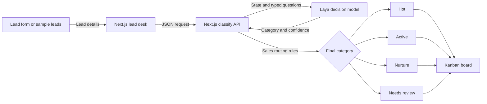

# Laya Dealership Lead Triage

A local-first demo that routes dealership web leads into an actionable sales kanban. It uses [Laya](https://huggingface.co/convaiinnovations/laya), an open-weight decision model, to assess purchase readiness, then applies explicit sales rules so the team gets a clear next step for every lead.

> This is a demo, not a production CRM. It uses fictional sample leads, keeps custom test leads in browser memory, and does not persist submissions.

## What it does

- Classifies 12 simulated website leads with Laya.
- Lets you submit a test lead through the form and see its result on the board.
- Routes leads into four sales action buckets.
- Shows Laya's suggested category and confidence when sales guardrails change the final route.
- Runs locally with Docker Compose; CPU is the default, with an optional NVIDIA GPU override.

## Sales action buckets

| Category | Routing rule | Recommended action |
| --- | --- | --- |
| **Hot** | Purchase or test-drive timeline is within 7 days | Call within 5 minutes |
| **Active** | Qualified purchase timeline is 8–30 days | Respond today |
| **Nurture** | Purchase is more than 30 days away or early-stage research | Schedule a helpful follow-up |
| **Needs review** | Service/parts, missing contact details, duplicate/spam, or unclear request | Check before routing |

The timeline, request type, and contactability rules are enforced by the app after Laya returns its prediction. The UI marks cases where a guardrail overrides the model's suggestion.

## Demo flow



## Run locally

### Requirements

- Docker Desktop with Docker Compose v2
- 8 GB or more of available memory is recommended for the model container
- Internet access for the first image build and model download

### Start

```bash
git clone https://github.com/Rafash-Wiz/laya-dealership-lead-triage.git
cd laya-dealership-lead-triage
cp .env.example .env
docker compose up --build -d
```

On Windows PowerShell, use `Copy-Item .env.example .env` instead of `cp` if needed.

Open **http://localhost:3000**, then select **Classify 12 leads**. The first build installs PyTorch and Laya; the first model request downloads the selected checkpoint, so startup and first classification can take a few minutes. Model files are cached in the `model-cache` Docker volume.

Use **Test a lead** to submit a lead through the form. The API sends it to Laya, applies sales routing rules, and places the result in the kanban. Try a service/parts request or omit both contact methods to see the **Needs review** route. Test submissions remain in that browser tab's memory until you reset the demo or reload the page.

### Check services

```bash
docker compose ps
curl http://localhost:8000/health
```

Follow Laya startup or model download progress with:

```bash
docker compose logs -f laya
```

### Stop

```bash
docker compose down
```

To also remove cached model files:

```bash
docker compose down --volumes
```

## Optional NVIDIA GPU

For a compatible NVIDIA GPU, driver, and NVIDIA Container Toolkit, use the CUDA override:

```bash
docker compose -f compose.yaml -f compose.cuda.yaml up --build -d
```

CPU remains the default and requires no GPU configuration.

## Architecture

| Component | Role |
| --- | --- |
| `web/` | Next.js interface with lead form, status cards, and kanban board |
| `web/app/api/classify/route.js` | Server-side API bridge to Laya and deterministic sales guardrails |
| `Dockerfile` | Laya API image with CPU PyTorch by default |
| `compose.yaml` | Laya and Next.js services, health check, local ports, and model cache volume |
| `compose.cuda.yaml` | Optional NVIDIA GPU configuration |

The browser calls the Next.js API route. That route calls Laya over the private Compose network, so the model service does not need to be exposed directly to the browser.

## API example

The Laya endpoint is available locally at `http://localhost:8000/v1/systemone`. `request.example.json` demonstrates Laya's state-plus-typed-questions request shape. In the app, the Next.js route adapts dealership lead data to the decision request and combines the model result with explicit routing rules.

## Configuration

Copy `.env.example` to `.env` to configure the service. The defaults bind Laya to localhost on port `8000`, use CPU inference, and do not require an API key. Set `LAYA_API_KEY` to require a bearer key for API requests. Keep the service on localhost for local use; before remote access, use authentication and a TLS reverse proxy.

## Model and evaluation notes

This demo uses the `typed-decisions` Laya checkpoint. Its model card describes fine-tuning on four synthetic workflows and cautions that it is a specialist; dealership lead routing is outside those listed workflows. Accordingly, the deterministic sales rules enforce the final action bucket, and the sample confidence values should be treated as demo signals rather than validated business probabilities. Evaluate on representative, labeled dealership leads before relying on model predictions in a live workflow.

See the [Laya model family](https://huggingface.co/convaiinnovations/laya) and [typed-decisions checkpoint](https://huggingface.co/convaiinnovations/laya-typed-decisions) for model details and license information.

## Privacy and production use

- All included names and contact details are fictional; sample emails use the reserved `.test` domain.
- Test submissions are sent to the local model service and are held in browser memory only.
- The demo has no database, authentication for the web UI, CRM integration, or production lead persistence.
- Do not expose the default local services publicly. Add access controls, secure transport, storage and retention policies before adapting this project for real customer information.
